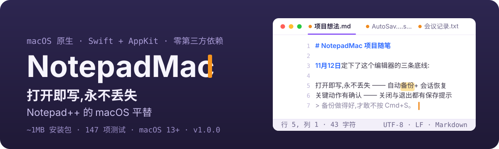
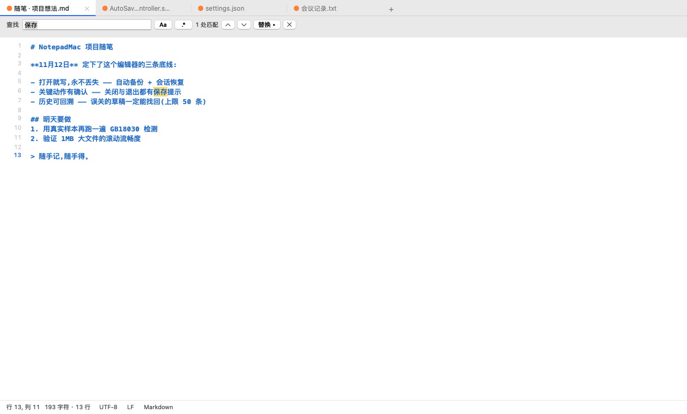
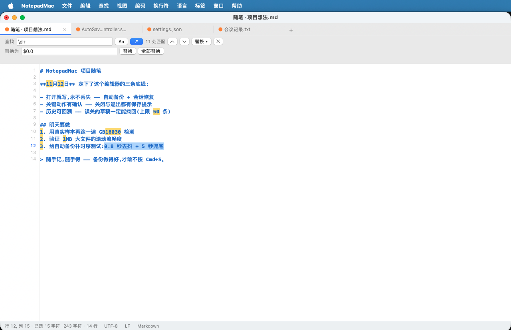
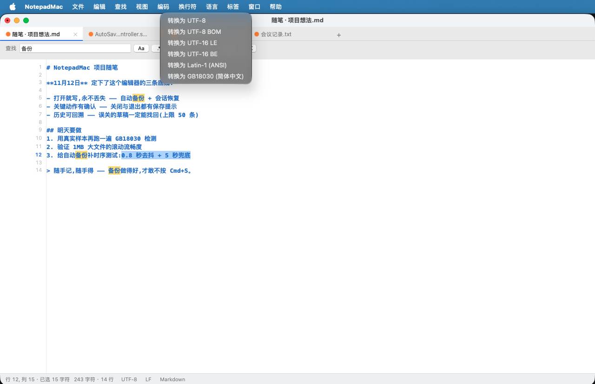
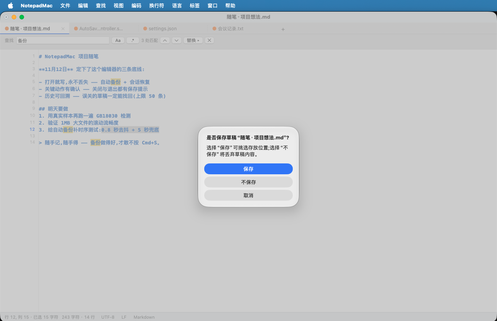
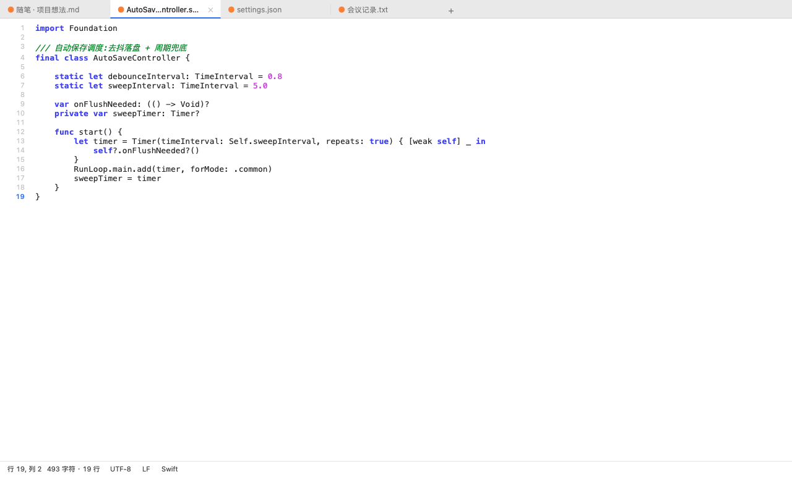
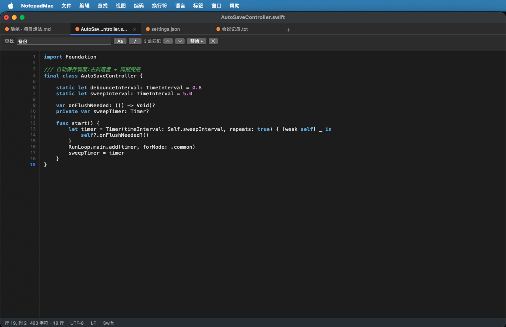

<p align="center">
  
</p>

<p align="center">
  <a href="https://ifdian.net/a/anycode"></a>
</p>

**A native macOS text editor · A worthy Notepad++ alternative.**

Built with pure Swift + AppKit, zero third-party dependencies, no Electron. Core design philosophy: **open and type, never lose anything** — auto backup + session restore as double insurance. Close the app and reopen it: everything is exactly as you left it.

## Screenshots

**Main window**: full menu bar included, Markdown highlighting + find highlighting + multiple tabs, with a status bar showing line:column / selection / encoding / line endings / language in real time



**Find / Replace**: regex `\d+` highlights all 11 matches, `$0` backreference replacement



**Encoding conversion**: one-click conversion between UTF-8 / UTF-8 BOM / UTF-16 LE·BE / Latin-1 / GB18030 — no broken text across platforms



**Save confirmation**: closing a tab or quitting always prompts when there are unsaved changes — accidental closes lose nothing



**Code mode**: Swift syntax highlighting + line numbers, following system light/dark appearance

<table>
  <tr>
    <td></td>
    <td></td>
  </tr>
  <tr>
    <td align="center">Light · Swift syntax highlighting + line numbers</td>
    <td align="center">Dark · follows system appearance</td>
  </tr>
</table>

**Status bar close-up**: line:column · selected characters · total characters · line count · encoding · line ending · language


## How "never lose anything" actually works

<p align="center">
  
</p>

Edits are snapshot-written 0.8s after typing stops, plus a 5s periodic sweep; synced to disk on tab switch and app blur; everything is flushed and the session recorded before a normal quit. Crashes, force quits, and accidental closes lose nothing — after a restart all tabs come back, **including unsaved content**.

## Why NotepadMac

| Pain point | NotepadMac's answer |
|---|---|
| macOS built-in text editing is too weak | Multi-tab, line numbers, find & replace (regex), syntax highlighting for 11 languages, encoding / line-ending handling — all included |
| Editor crashes or closes by mistake, content lost | **Triple auto backup** (0.8s debounce + 5s sweep + save-on-quit), unsaved content restored across restarts, save confirmation on every close/quit |
| Notepad++ doesn't exist on macOS | Full interaction parity: Ctrl+Tab switching, Cmd+1..9 direct access, right-click close, status bar, line numbers, GBK encoding detection |
| VS Code is too heavy, slow to start | Native AppKit, opens and types instantly, app bundle is only ~1MB |

## Features

### Core capabilities
- **Auto backup**: edits are snapshot-written 0.8s after typing stops, plus a 5s periodic sweep; synced to disk on tab switch and app blur. Survives crashes
- **Explicit save**: Cmd+S writes back to the original file; unnamed drafts prompt for a save location. Tab ● marker = unsaved changes
- **Save confirmation**: closing a tab / quitting the app always prompts when there are unsaved changes: `Save / Don't Save / Cancel`
- **Session restore**: all tabs (order, active position, cursor, scroll position, encoding, line endings, language) are recorded on quit and fully restored on launch — **including unsaved changes**
- **Document history**: closed documents are automatically kept (including unsaved content), 10 recent shown by default, 50 max; Cmd+Shift+T reopens the last closed document
- **Draft mode**: Cmd+N creates an unnamed draft — just type, no save dialog needed
- **Open any text file**: Cmd+O, drag & drop onto the window, Finder "Open With", double-click file association (.txt/.md/.json/.py/.swift and 50+ more extensions)

### Notepad++ parity
- Multi-tab editing: wrap display, drag to reorder, Ctrl+Tab cycling, Cmd+1..9 direct access, middle-click close, context menu (close others/all)
- Line number gutter: correct soft-wrap handling, current line highlighted
- Status bar: line:column, selection character count, total characters, line count, encoding, line ending type, current language
- Find/replace: highlight all matches, case sensitivity, regex (with `$n` backreferences), replace/replace all
- Go to line (Cmd+L)
- Encoding: auto-detect UTF-8 / UTF-8 BOM / UTF-16 LE/BE / GB18030 / Latin-1, menu conversion & save
- Line endings: detect & preserve LF / CRLF / CR, one-click menu conversion (no broken lines across platforms)
- Syntax highlighting: Markdown / JSON / Python / JavaScript·TS / Swift / C·C++ / HTML / XML / Shell / YAML / Java, auto-detected by extension; auto-degrades for very large files
- Insert timestamp (Cmd+;), case conversion, font zoom (Cmd +/-/0), font panel (Cmd+T)
- Word wrap toggle, window always-on-top, dark mode follows system

## Quick start

No full Xcode needed — just Command Line Tools (`xcode-select --install`):

```bash
cd notepadmac
bash build.sh               # builds to build/NotepadMac.app
open build/NotepadMac.app   # run directly
bash build.sh --install     # or install to /Applications
```

### Running unit tests

No XCTest in this environment (it ships only with full Xcode), so a standalone test runner is used:

```bash
bash Scripts/run_tests.sh   # 147 assertions, exit code 0 = all passed
```

## Keyboard shortcuts

<details>
<summary><b>Full shortcut table (click to expand)</b></summary>

| Action | Shortcut |
|---|---|
| New tab | Cmd+N |
| Open file | Cmd+O |
| Save now | Cmd+S (auto-save is always on; this is a manual trigger) |
| Save as | Cmd+Shift+S |
| Close tab | Cmd+W |
| Find / Replace | Cmd+F / Cmd+Alt+F |
| Find next / previous | Cmd+G / Cmd+Shift+G |
| Go to line | Cmd+L |
| Insert timestamp | Cmd+; |
| Next / previous tab | Ctrl+Tab / Ctrl+Shift+Tab |
| Go to tab N | Cmd+1..9 |
| Zoom in / out / actual size | Cmd+= / Cmd+- / Cmd+0 |
| Font panel | Cmd+T |

</details>

## Data directory

All data is stored under `~/Library/Application Support/NotepadMac/`:

```
session.json          # session state (tabs/order/cursor/scroll/encoding/EOL/language)
drafts/<UUID>.txt     # draft content + crash-recovery snapshots of named files
```

Delete this directory to fully reset the app (there is an "Open Data Directory" item in the Help menu).

## Project structure

<details>
<summary><b>Directory & module notes (click to expand)</b></summary>

```
Package.swift                  # SPM: NotepadCore (pure logic library) + NotepadMac (AppKit app)
build.sh                       # .app bundle build (compile/assemble/icon/sign)
Scripts/
  Info.plist                   # bundle description (includes file type associations)
  make_icon.swift              # CoreGraphics icon generator
  run_tests.sh                 # standalone test runner (no XCTest needed)
Sources/NotepadCore/           # pure logic layer (independently testable)
  TextCodec.swift              #   encoding detection/conversion, line-ending detection/normalization
  LineIndex.swift              #   line index (UTF-16 coordinate system)
  FindEngine.swift             #   find/replace engine (plain + regex)
  SyntaxHighlighter.swift      #   syntax highlighting rule engine (11 languages)
Sources/NotepadMac/            # AppKit application layer
  main.swift / AppDelegate.swift / MainWindowController.swift
  EditorTab.swift              #   tab model (view + metadata + serialization)
  EditorTextView.swift / LineNumberRulerView.swift
  TabBarView.swift / StatusBarView.swift / FindBarView.swift
  SessionStore.swift           #   session.json + drafts directory management
  AutoSaveController.swift     #   0.8s debounce + 5s sweep scheduling
  SyntaxColors.swift / Menus.swift / Preferences.swift / FileDropView.swift
TestsStandalone/main.swift     # 147 unit assertions
```

</details>

## Known limitations (v2 candidates)

- With a very large number of tabs, the tab bar squeezes tabs equally wide (no horizontal scrolling)
- Large files (>1MB) disable syntax highlighting automatically for smoothness
- No column editing, bookmarks, macros, or plugin system (advanced Notepad++ features)

## Support

If NotepadMac helps you, please give it a **Star ⭐** — bug reports and feature requests are welcome at [Issues](../../issues), PRs are welcome too.

### ☕ Support this project

Your sponsorship keeps the project going. It is entirely optional — stars, issue reports and sharing help just as much.

<p align="center">
  <a href="https://ifdian.net/a/anycode"></a>
</p>
<p align="center">
  <a href="https://ifdian.net/a/anycode"></a>
</p>
