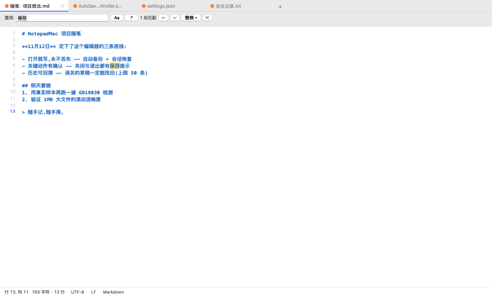
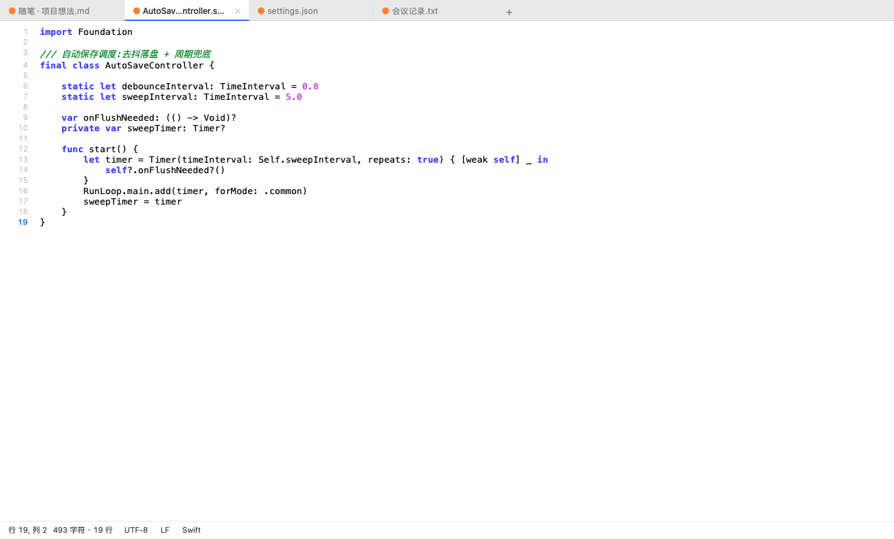

# NotepadMac

**macOS 原生文本编辑器 · 对标 Windows Notepad++ 的平替之作**

纯 Swift + AppKit 构建,零第三方依赖,无 Electron。核心设计哲学:**打开即写,永不丢失** —— 自动备份 + 会话恢复双保险,关闭应用再打开,一切如初。

## 界面预览

**随笔模式:Markdown 高亮 + 查找高亮 + 多标签**



**代码模式:Swift 语法高亮 + 行号**



## 为什么选它

| 痛点 | NotepadMac 的答案 |
|---|---|
| macOS 自带文本编辑功能太弱 | 多标签、行号、查找替换(正则)、语法高亮 11 种语言、编码/换行符处理,一个不少 |
| 编辑器写一半崩溃/误关就丢 | **三重自动备份**(0.8s 去抖 + 5s 兜底 + 退出落盘),未保存内容跨重启恢复,关闭/退出必弹保存确认 |
| Notepad++ 在 macOS 没有 | 交互全面对标:Ctrl+Tab 切换、Cmd+1..9 直达、右键关闭、状态栏、行号、GBK 编码识别 |
| VS Code 太重、启动慢 | 原生 AppKit,秒开秒写,安装包仅 ~1MB |

## 特性

### 核心能力
- **自动备份**:编辑 0.8 秒后自动写入应用内快照,另有 5 秒周期兜底;切换标签、应用失焦时同步落盘。崩溃也不丢内容
- **显式保存**:Cmd+S 写回原文件;未命名草稿弹出存放位置选择。标签 ● 标记 = 有未保存到原文件的修改
- **保存确认**:关闭标签 / 退出应用时,只要有未保存修改必然弹窗:`保存 / 不保存 / 取消`
- **会话恢复**:所有标签(顺序、激活位置、光标、滚动位置、编码、换行符、语言)退出时记录,启动时完整还原,**未保存的修改也一并恢复**
- **历史文档**:关闭过的文档自动留底(含未保存内容),默认显示最近 10 条、上限 50 条;Cmd+Shift+T 一键重开上次关闭的文档
- **草稿本模式**:Cmd+N 新建未命名草稿,直接写,无需保存对话框
- **打开任意文本文件**:Cmd+O、拖拽文件到窗口、Finder「打开方式」、双击文件关联(.txt/.md/.json/.py/.swift 等五十余种扩展名)

### Notepad++ 对标功能
- 多标签编辑:折行展示、拖拽排序、Ctrl+Tab 循环切换、Cmd+1..9 直达、中键关闭、右键菜单(关闭其他/全部)
- 行号栏:正确处理软换行,当前行高亮
- 状态栏:行:列、选区字符数、总字符数、行数、编码、换行符类型、当前语言
- 查找/替换:全部匹配高亮、忽略大小写、正则(支持 $n 反向引用)、替换/全部替换
- 跳转到行(Cmd+L)
- 编码:自动检测 UTF-8 / UTF-8 BOM / UTF-16 LE/BE / GB18030 / Latin-1,菜单转换保存
- 换行符:检测并保持 LF / CRLF / CR,菜单一键转换(跨平台文本不乱行)
- 语法高亮:Markdown / JSON / Python / JavaScript·TS / Swift / C·C++ / HTML / XML / Shell / YAML / Java,按扩展名自动识别;超大文件自动降级
- 插入时间戳(Cmd+;)、大小写转换、字体缩放(Cmd +/-/0)、字体面板(Cmd+T)
- 自动换行开关、窗口置顶、深色模式跟随系统

## 快捷键

| 操作 | 快捷键 |
|---|---|
| 新建标签 | Cmd+N |
| 打开文件 | Cmd+O |
| 立即保存 | Cmd+S(自动保存常开,此为手动触发) |
| 另存为 | Cmd+Shift+S |
| 关闭标签 | Cmd+W |
| 查找 / 替换 | Cmd+F / Cmd+Alt+F |
| 查找下一个 / 上一个 | Cmd+G / Cmd+Shift+G |
| 跳转到行 | Cmd+L |
| 插入时间戳 | Cmd+; |
| 下一个 / 上一个标签 | Ctrl+Tab / Ctrl+Shift+Tab |
| 直达标签 N | Cmd+1..9 |
| 放大 / 缩小 / 实际大小 | Cmd+= / Cmd+- / Cmd+0 |
| 字体面板 | Cmd+T |

## 构建与安装

无需完整版 Xcode,装好 Command Line Tools 即可(`xcode-select --install`):

```bash
cd notepadmac
bash build.sh               # 构建到 build/NotepadMac.app
open build/NotepadMac.app   # 直接运行
bash build.sh --install     # 或安装到 /Applications
```

### 运行单元测试

本环境无 XCTest(仅随完整 Xcode 分发),采用独立测试运行器:

```bash
bash Scripts/run_tests.sh   # 94 项断言,退出码 0 = 全部通过
```

## 数据目录

所有数据存储于 `~/Library/Application Support/NotepadMac/`:

```
session.json          # 会话状态(标签/顺序/光标/滚动/编码/行尾/语言)
drafts/<UUID>.txt     # 草稿正文 + 命名文件的崩溃恢复快照
```

删除该目录即可完全重置应用(帮助菜单里有「打开数据目录」)。

## 工程结构

```
Package.swift                  # SPM:NotepadCore(纯逻辑库) + NotepadMac(AppKit 应用)
build.sh                       # 构建 .app bundle(编译/组装/图标/签名)
Scripts/
  Info.plist                   # bundle 描述(含文件类型关联)
  make_icon.swift              # CoreGraphics 图标生成器
  run_tests.sh                 # 独立测试运行器(无需 XCTest)
Sources/NotepadCore/           # 纯逻辑层(可独立测试)
  TextCodec.swift              #   编码检测/编码转换、换行符检测/归一化
  LineIndex.swift              #   行号索引(UTF-16 坐标系)
  FindEngine.swift             #   查找/替换引擎(普通+正则)
  SyntaxHighlighter.swift      #   语法高亮规则引擎(11 种语言)
Sources/NotepadMac/            # AppKit 应用层
  main.swift / AppDelegate.swift / MainWindowController.swift
  EditorTab.swift              #   标签模型(视图+元数据+序列化)
  EditorTextView.swift / LineNumberRulerView.swift
  TabBarView.swift / StatusBarView.swift / FindBarView.swift
  SessionStore.swift           #   session.json + drafts 目录管理
  AutoSaveController.swift     #   去抖 0.8s + 周期 5s 调度
  SyntaxColors.swift / Menus.swift / Preferences.swift / FileDropView.swift
TestsStandalone/main.swift     # 94 项单元断言
```

## 已知边界(v2 候选)

- 标签数量极多时标签栏等宽挤压(无横向滚动)
- 大文件(>1MB)自动关闭语法高亮以保证流畅
- 无列编辑、书签、宏、插件系统(Notepad++ 高级特性)
